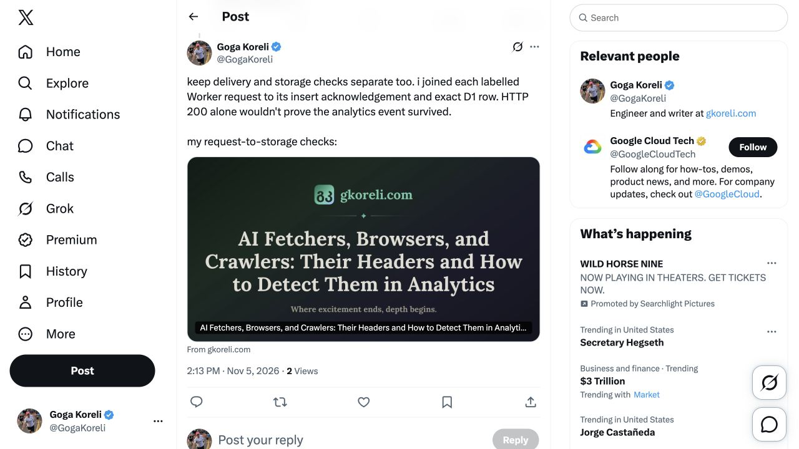

# November 5 additional replies and follow-up check

The owner asked for five more replies or follow-ups on each platform. The duplicate request was handled once. Five additional X replies and five Reddit comments were submitted to ten discussions not used in the first batch. All ten canonical permalinks were reopened and their text and blog link/card checked in the signed-in owner browser.

## Responses found

No new bot-header campaign response was found in either loaded notification feed. The original X launch showed zero replies; the earlier Nullprint reply also showed zero replies. The previous SearchAPIs comment had no displayed child response. Those specific checks do not establish that every hidden, filtered or unnotified response is absent. No unrelated conversations were used to promote this article.

The original X launch displayed 10 views at this check, which may include owner views. An older Reddit notification about the CloudFlare post reaching 2,062 views was not treated as a fresh count. No comparable performance baseline, organic click count or reader-use outcome is established.

## Published contributions

| Platform | Discussion | Published contribution |
| --- | --- | --- |
| X | [Massive: IP-list verification](https://x.com/joinmassive/status/2118433861180760195) | [Permalink](https://x.com/GogaKoreli/status/2118465476112392588) |
| X | [Phillip Shoemaker: claims versus verified identity](https://x.com/pbsIdentity/status/2118428920022229211) | [Permalink](https://x.com/GogaKoreli/status/2118465769076031773) |
| X | [John: Web Bot Auth component coverage](https://x.com/hottubjohn/status/2118423336674037810) | [Permalink](https://x.com/GogaKoreli/status/2118466124098785464) |
| X | [Valerion: URL controls for access testing](https://x.com/AetherC0de/status/2118409822076809614) | [Permalink](https://x.com/GogaKoreli/status/2118466438608625807) |
| X | [Google Cloud Tech: validate telemetry persistence](https://x.com/GoogleCloudTech/status/2118459932525863420) | [Permalink](https://x.com/GogaKoreli/status/2118466766771003604) |
| Reddit | [Logwick: classifier test fixtures](https://www.reddit.com/r/SEO_tool_dev/comments/1up07ai/logwick_selfhosted_ai_bot_crawler_analytics_from/) | [Permalink](https://www.reddit.com/r/SEO_tool_dev/comments/1up07ai/comment/19s746xxtvn7o/) |
| Reddit | [SEOToolTips: freeze historical receipt provenance](https://www.reddit.com/r/SEOToolTips/comments/1x5zp5b/ai_in_server_logs_is_basically_an_archaeological/) | [Permalink](https://www.reddit.com/r/SEOToolTips/comments/1x5zp5b/comment/19s749cc4xr2b/) |
| Reddit | [GEO optimization: answer correctness versus fresh fetch](https://www.reddit.com/r/GEO_optimization/comments/1w71sqk/i_probed_1046_sites_with_8_ai_crawler_useragents/) | [Permalink](https://www.reddit.com/r/GEO_optimization/comments/1w71sqk/comment/19s74cjs8qpfm/) |
| Reddit | [CloudFlare: real Gemini request versus UA probes](https://www.reddit.com/r/CloudFlare/comments/1vi78ao/ai_bots_allowed_in_robotstxt_full_prerendered/) | [Permalink](https://www.reddit.com/r/CloudFlare/comments/1vi78ao/comment/19s74f33um4w2/) |
| Reddit | [CloudFlare: browser claims do not prove JavaScript execution](https://www.reddit.com/r/CloudFlare/comments/1x3jnw9/metaexternalagent_generated_over_125k/) | [Permalink](https://www.reddit.com/r/CloudFlare/comments/1x3jnw9/comment/19s74gjczmyhw/) |

## Exact submitted copy

### X 1: Massive: IP-list verification

[Published](https://x.com/GogaKoreli/status/2118465476112392588) · 226/280 weighted characters · canonical owner view verified.

```text
IP verification needs a third result besides real/fake. my controlled Claude-User fetch came from outside Anthropic's current feed, so i store 'not listed' without calling it an impersonator.

my tests: https://gkoreli.com/ai-fetcher-browser-crawler-headers
```

### X 2: Phillip Shoemaker: claims versus verified identity

[Published](https://x.com/GogaKoreli/status/2118465769076031773) · 243/280 weighted characters · canonical owner view verified.

```text
i log the client claim, verified publisher and signed fields separately. chatgpt's browser and curl shared a signer on my site, but needed different client labels. a trusted name alone loses that detail.

my live tests: https://gkoreli.com/ai-fetcher-browser-crawler-headers
```

### X 3: John: Web Bot Auth component coverage

[Published](https://x.com/GogaKoreli/status/2118466124098785464) · 237/280 weighted characters · canonical owner view verified.

```text
the coverage is worth checking too. dot's chrome + curl had valid chatgpt signatures on my site, but path/query/UA weren't covered. changing those fields still passed my local replay.

my captured proofs + checks: https://gkoreli.com/ai-fetcher-browser-crawler-headers
```

### X 4: Valerion: URL controls for access testing

[Published](https://x.com/GogaKoreli/status/2118466438608625807) · 242/280 weighted characters · canonical owner view verified.

```text
URL controls can change an access test. perplexity failed on my ?probe= URL, then answered correctly from canonical/# inputs. # doesn't reach the origin, so a working citation can't label a fresh request.

my controls: https://gkoreli.com/ai-fetcher-browser-crawler-headers
```

### X 5: Google Cloud Tech: validate telemetry persistence

[Published](https://x.com/GogaKoreli/status/2118466766771003604) · 247/280 weighted characters · canonical owner view verified.

```text
keep delivery and storage checks separate too. i joined each labelled Worker request to its insert acknowledgement and exact D1 row. HTTP 200 alone wouldn't prove the analytics event survived.

my request-to-storage checks: https://gkoreli.com/ai-fetcher-browser-crawler-headers
```

### Reddit 1: Logwick: classifier test fixtures

[Published](https://www.reddit.com/r/SEO_tool_dev/comments/1up07ai/comment/19s746xxtvn7o/) · 54 words · canonical owner view verified.

Current rule/context check: Expanded No Spam or Self-Promotion rule prohibits spam or unwanted commercial content; OP explicitly requests feedback. Reply supplies controlled noncommercial classifier fixtures.

```text
an API scraper can arrive with browser headers too. my authenticated context.dev search/scrape/crawl/answer trials produced 11 labelled page requests, all unsigned and without a vendor declaration; my collector stored 10 Browser and 1 Cloud Browser.

i'd keep operation, received headers and classifier result separate in test fixtures. my exact controls + stored rows: https://gkoreli.com/ai-fetcher-browser-crawler-headers
```

### Reddit 2: SEOToolTips: freeze historical receipt provenance

[Published](https://www.reddit.com/r/SEOToolTips/comments/1x5zp5b/comment/19s749cc4xr2b/) · 55 words · canonical owner view verified.

Current rule/context check: Current sidebar has one expanded rule requiring civility; community description invites tutorials/case studies/tool discussion. Existing thread discusses dated IP-list snapshots.

```text
also freeze the catalogue that renders the verdict. my receipt replay used today's publisher-name table, so adding ChatGPT/ExaUser would change an older 'Other' display. i now store the display profile with new evidence and keep a historical baseline for legacy rows.

46 saved receipts still reproduce after the fix. my code + acceptance checks: https://gkoreli.com/ai-fetcher-browser-crawler-headers
```

### Reddit 3: GEO optimization: answer correctness versus fresh fetch

[Published](https://www.reddit.com/r/GEO_optimization/comments/1w71sqk/comment/19s74cjs8qpfm/) · 57 words · canonical owner view verified.

Current rule/context check: Expanded rules prohibit spam links and posts selling products/services. This technical reply adds a bounded provider-control finding and identifies the linked study as ours; it does not sell a service.

```text
even a correct cited answer doesn't prove a fresh fetch. in my controlled Perplexity tests, canonical/fragment inputs returned the right source details, but no attributable request appeared in the bounded Worker tail; the separately labelled synthetic control did appear.

i record answer correctness, provider disclosure and received requests separately. my prompts, URL controls and capture limits: https://gkoreli.com/ai-fetcher-browser-crawler-headers
```

### Reddit 4: CloudFlare: real Gemini request versus UA probes

[Published](https://www.reddit.com/r/CloudFlare/comments/1vi78ao/comment/19s74f33um4w2/) · 55 words · canonical owner view verified.

Current rule/context check: Current community sidebar and linked wiki read; helpful relevant technical detail, appropriate scope and Reddit-policy compliance. No security setting change or block diagnosis claimed.

```text
match the assigned URL in your logs before filtering on bot names. my real Gemini follow-up arrived with the entire user-agent Google, no signature, and stayed Unresolved in my analytics. named-bot filters would've missed it.

check edge-security events separately; a missing Worker hit doesn't prove a Cloudflare block. my actual prompts + received headers: https://gkoreli.com/ai-fetcher-browser-crawler-headers
```

### Reddit 5: CloudFlare: browser claims do not prove JavaScript execution

[Published](https://www.reddit.com/r/CloudFlare/comments/1x3jnw9/comment/19s74gjczmyhw/) · 58 words · canonical owner view verified.

Current rule/context check: Same current CloudFlare wiki and sidebar context reviewed; OP explicitly asks whether others observed browser-shaped crawler traffic. Reply supplies a bounded counterexample without identifying their traffic or claiming JavaScript execution.

```text
browser-style headers don't establish that the crawler ran JavaScript. my controlled Grok task produced 11 unsigned Chrome/Safari-looking GETs, all stored Browser by my own collector; that experiment didn't prove JS execution either.

i'd keep the native Cloudflare identity/action and raw UA on the same request before connecting those browser-shaped hits to Meta. my headers + stored-row checks: https://gkoreli.com/ai-fetcher-browser-crawler-headers
```

## Evidence and limits

The comments add specific checks: browser-shaped API scraper traffic, frozen receipt-display provenance, correct answers versus attributable fresh fetches, Gemini requests missed by named-bot filters, and browser claims versus JavaScript execution. They do not diagnose the other authors' sites or extend the controlled sample into a detection rate. The article's AI-coauthor disclosure remains visible.

Current expanded rules were read in [SEO_tool_dev](https://www.reddit.com/r/SEO_tool_dev/comments/1up07ai/logwick_selfhosted_ai_bot_crawler_analytics_from/), [SEOToolTips](https://www.reddit.com/r/SEOToolTips/comments/1x5zp5b/ai_in_server_logs_is_basically_an_archaeological/) and [GEO_optimization](https://www.reddit.com/r/GEO_optimization/comments/1w71sqk/i_probed_1046_sites_with_8_ai_crawler_useragents/). The [CloudFlare wiki](https://www.reddit.com/r/CloudFlare/wiki/index/) and both discussion sidebars were read. The SEO_tool_dev promotion rule specifies spam/unwanted commercial content; this reply supplies requested technical feedback, without selling anything. SEOToolTips is marked Restricted but its comment composer accepted the contribution and the canonical owner view was verified.

No DMs, manual votes/reactions, additional original posts, deletions, moderation workarounds, setting changes or scheduled follow-ups were made. Reddit's default self-votes and owner verification views are not audience engagement.

Raw captures and account UI stay in ignored private worklog storage. The [structured receipt](followups-publication-2026-11-05.json) preserves exact public copies, destinations, collection times and bounded response checks. Independent public visibility and moderation placement remain unverified. The [first batch](replies-2026-11-05.md) stays unchanged.


