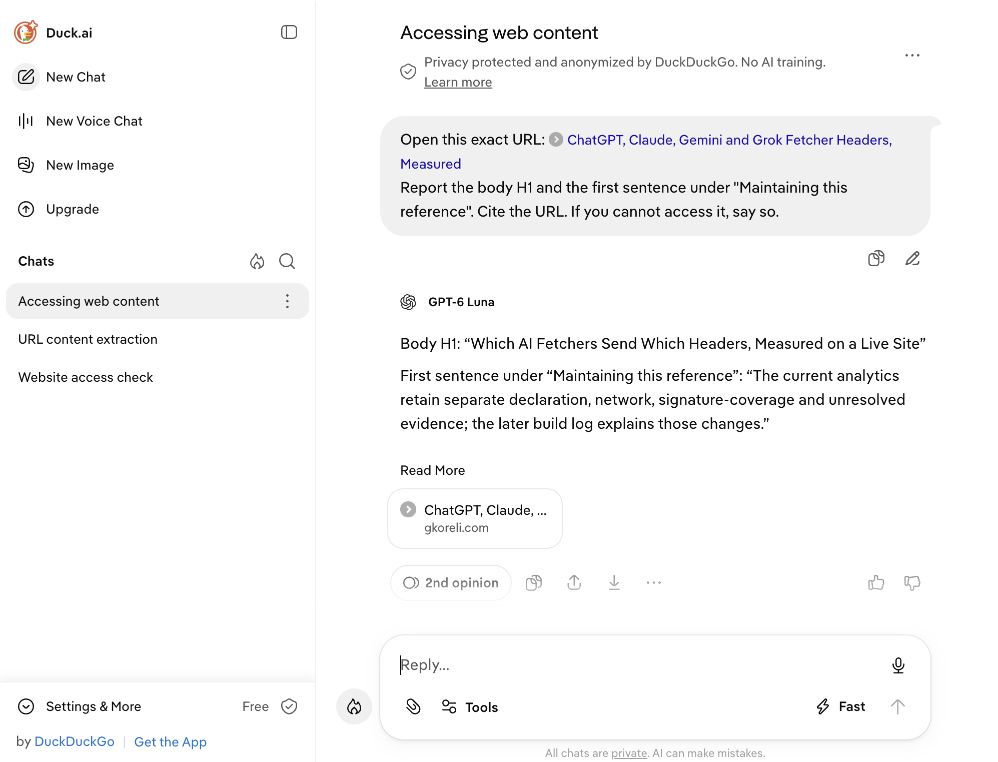

# Testing AI Search, Fetch, and Crawl Against My Analytics

Working draft, November 4, 2026. Unpublished. The [first provider batch](research/ai-bot-analytics-grilling/01-first-batch.md) and thirteen exact storage checks are complete; authenticated Firecrawl/Agent tests and broader repeats remain open. [Research worklist](research/ai-bot-analytics-grilling/00-worklist.md).

An AI search result, a page fetch and a cited answer leave different evidence. In the first trials for this article, Exa returned search highlights, its separate fetch tool requested my page as `ExaUser`, and Duck.ai answered through a signed `DuckAssistBot` request. Bing's AI Mode cited my earlier study while dropping some of its limits. I want to compare the whole path: what I asked a service to do, what it returned, what reached Cloudflare, and what my analytics recorded.

My [earlier fetcher study](/which-ai-fetchers-send-which-headers) captured ten assistants in September. The [follow-up](/ai-fetcher-research-from-experiments-to-a-cited-reference) explains later tests and external use of that work. This article starts a repeatable provider catalogue: separate operations, named conditions, real failures and open questions. The earlier results retain their dates.

Codex operated the services for this batch, with my authorization and existing account access. These are deliberately elicited tests. Eight known trial requests were stored as Browser, two as Unresolved and three as AI Assistant; those thirteen observations are not an organic growth measurement or a count of people.

## The kinds of bots we need to distinguish

### Search crawlers and search results

A search crawler maintains an index. A search operation can return something already in that index. Exa documents `ExaSearchBot` for discovery/indexing and `ExaUser` for user-requested pages. DuckDuckGo separately documents `DuckDuckBot` and `DuckAssistBot`. Bing documents `bingbot` among its crawlers. Those names give us hypotheses to test against actual requests. [Exa crawler information](https://crawler.exa.ai/), [DuckDuckBot](https://duckduckgo.com/duckduckgo-help-pages/results/duckduckbot), [DuckAssistBot](https://duckduckgo.com/duckduckgo-help-pages/results/duckassistbot), [Bing crawlers](https://www.bing.com/webmasters/help/which-crawlers-does-bing-use-8c184ec0).

### Prompted fetchers, extractors and browsers

A known-URL retrieval asks for a particular page. The service can return cached text, fetch the page, render it in a browser, or fail. The interface's word “fetch” does not settle which happened. We need its returned result and the publisher's evidence.

### Crawlers, link mappers and research agents

Mapping discovers URLs; crawling can retrieve several pages; research can select sources and synthesize an answer. These operations deserve separate rows even when one provider exposes all of them. A seed page succeeding does not establish that a crawl completed, and a completed answer does not establish that its citations support every sentence.

## How each trial is recorded

### The trigger and its conditions

Each record names the product, operation, API/MCP/browser interface, account/model state, exact input, cache policy, output limits and time. I assign a unique query label to each direct retrieval. The answer is absent from the prompt. That label supports experimental attribution; it does not force the provider to fetch fresh content.

### The request and the stored observation

The useful chain is submission → provider result → origin request → storage acknowledgement → exact stored row. I keep raw logs and references privately and publish reviewed facts. A successful signature is another field in that chain, with its covered components preserved. Each missing stage remains visible.

For this batch, all thirteen exact assigned-label requests have matching stored rows and full receipt equality. The indexed Wrangler readback reported 26 rows read, zero writes and one attempt. A separate constant access check reported zero reads and writes. The existing collector performed the ordinary experimental inserts; I changed no runtime classification rule.

### The answer and its evidence

I compare a requested H1 against the body H1, a quote against the source sentence, and metadata dates against the fields they purport to describe. A citation is a supported controlled discovery outcome. It can coexist with an inaccurate summary.

## Exa

### Search through MCP

The hosted MCP server's live schema exposed `web_search_exa` and `web_fetch_exa`. Search required both `query` and `objective`; fetch accepted `urls` and `maxCharacters`. One search returned the original article with highlights. The local end-to-end call took 1.180 seconds; that single measurement is not a latency benchmark. [Official MCP implementation](https://github.com/exa-labs/exa-mcp-server).

### Fetch through MCP and the API playground

The separate MCP fetch returned the page text. The signed-in Contents playground also succeeded with full text and `maxAgeHours: 0`. Both assigned URLs reached the Worker with an `ExaUser/1.0` declaration and HTTP 200. The playground reported a per-call cost of $0.001 and a processing time near 1.235 seconds. The API and MCP expose different controls; those are separately recorded trials. [Contents API](https://exa.ai/docs/reference/get-contents).

### A subpage crawl that timed out

I enabled one subpage, targeted “prompts”, and kept the fresh-content setting. This separate call returned no results, `CRAWL_TIMEOUT`, an error field of 504, and a reported cost of zero. We have a concrete failed attempt to investigate, rather than a completed crawl to describe.

### Signature coverage and analytics

The two matched Exa fetches had Worker-verified signatures over the authority and `Signature-Agent`. Their paths, query strings, methods and User-Agents were unsigned. Both exact stored rows are `ai-assistant`, with signer display `Other`.

That display has a specific explanation: the [approved-name catalogue](../../analytics/src/signers.ts) contains `https://crawler.exa.ai`, while these requests name `https://exauser.crawler.exa.ai`. The exact-origin lookup returns Other for the latter. Display approval and successful verification are separate facts. I have not changed the catalogue or independently replayed the new proofs.

### Metadata that needs checking

Search returned the original September 3 publication timestamp. MCP fetch and API Contents presented November 4 as the publication date for the same article. The tracked source declares September 3, with a November 1 modification date. I have recorded the disagreement; the internal date-extraction cause remains unknown.

## DuckDuckGo and Duck.ai

### Search, DuckDuckBot and DuckAssistBot

The normal search page returned the article. DuckDuckGo documents its search crawler separately from the crawler used for AI-assisted answers, and says its traditional links largely come from Bing alongside its other sources. A search listing alone does not identify a newly triggered DuckDuckBot fetch. [Result sources](https://duckduckgo.com/duckduckgo-help-pages/results/sources).

### Asking Duck.ai to read a known URL

Two browser questions asked for the body H1 and the first sentence under “Maintaining this reference”. Both answers matched those parts of the source. The second trial ran while the approved Worker tail was active: its assigned URL received one HTTP 200 request declaring `DuckAssistBot/1.2`, followed by a storage acknowledgement classified as `ai-assistant`.

### What its signature established

The second trial's acknowledgement reported a verified DuckDuckGo proof. Its signature again covered authority and `Signature-Agent`, leaving the requested path and the User-Agent unsigned. This is fresh request evidence with the same important coverage limit as the older study. It is not a new independent replay or a count of people.

The screenshot establishes the visible question and answer. The request, signature outcome and exact stored row are separate evidence in the [batch record](research/ai-bot-analytics-grilling/first-batch-evidence.json).

## Bing and its AI Mode

### A search listing and a cited answer

Bing returned the article for the same site-scoped query used on DuckDuckGo. Its AI Mode then produced a source-linked summary. These interactions preceded the approved tail, so their origin requests are unobserved in this run. I have not established an on-demand `bingbot` trigger.

### The qualifications lost in the answer

The answer described a DuckDuckGo signing-key-directory check as network verification. It also described anonymous Grok requests as human visitors and generalized their acceptance by the tested classifier into a claim about server-side detection. The source separates network evidence from signature verification, calls Browser a request classification, and scopes its detection result to the rules tested.

That is useful evidence about this answer's fidelity. It does not reveal whether Bing used an old index version, selected misleading passages, or introduced the errors during synthesis.

## Tavily

### Search and page extraction

The API search returned three results for the same site-scoped query, with one reported credit. Extract returned the assigned article as Markdown, including its H1 and the maintenance sentence requested in the other trials. Its returned content was 52,439 characters, with zero failed URLs.

Three requests for that extraction label appeared in the stopped capture: two were stored Browser, one Unresolved, and all were unsigned. They claimed Chrome or Firefox rather than a Tavily bot name. One arrived during later operations, so the label alone cannot assign it to a particular internal task. These requests demonstrate a classification gap for this controlled sample; they do not identify every similarly shaped request elsewhere.

Across Extract, Map and Crawl, Cloudflare reported four ASNs and three countries for the eight labelled requests. All used HTTP/1.1. Six claimed Chrome and supplied navigation metadata, including `Sec-Fetch-User: ?1`. Two other browser claims omitted that metadata and remained Unresolved. The headers give the classifier observable facts, while the controlled API calls supply the automation context it does not otherwise have.

### Crawl, map and research

Map and Crawl both used depth one, breadth two, a two-result limit and no external domains. Map returned the query-bearing seed and its canonical form. Crawl returned content for those two URLs. Two URLs can therefore describe one article. The map label received one request stored Browser; the crawl label received four, stored as three Browser and one Unresolved.

The mini Research job then completed in a reported 29.52 seconds. It supplied no sources, said the H1 and maintenance sentence were unavailable, and misstated the signature coverage. The article's signature example covers authority and Signature-Agent; its User-Agent is unsigned. Successful direct extraction did not ensure a sound research answer, and the failed answer does not tell us which internal retrieval step failed. [Tavily Extract](https://docs.tavily.com/documentation/api-reference/endpoint/extract), [Crawl](https://docs.tavily.com/documentation/api-reference/endpoint/crawl), [Research](https://docs.tavily.com/documentation/api-reference/endpoint/research).

### Reported cost and browser access

Extract, Map and Crawl each reported zero credits in their response fields. Research returned no usage field, so its cost is unresolved. Those values are not independently measured billing. The signed-in playground was inspected; its Research button opened a separate interface asking for a key. The completed research trial used the API, without putting the key into a browser prompt or URL.

## Firecrawl

### Search and scrape

Firecrawl's public MCP endpoint exposed Search, Scrape and Parse schemas. Both attempted Search and Scrape calls returned tool errors saying anonymous access was unavailable, inside transport HTTP 200 responses. A transport success must not turn into a successful trial in the comparison. [Official keyless MCP guidance](https://docs.firecrawl.dev/mcp-server/keyless).

A later control completed normal MCP initialization and repeated one small search. The same access error remained. That rules out merely omitting initialization as a sufficient explanation for this run; the underlying access cause remains unknown.

The public browser playground subsequently returned three search results with content scraping disabled. A separate fresh Markdown scrape reached my origin and stored a Browser observation, but the result UI crashed with a JavaScript `join` error. After reopening the playground, its recent-run history labelled that scrape Success. Delivery, backend status and a usable interface can disagree.

### Crawl, map and agent output

The browser crawl used a two-page limit, depth one and fresh content; the UI reported success with two results. One exact seed request reached the origin, unsigned, and was stored Browser. Its JSON download required an account. The browser map, separately limited to two URLs, displayed one canonical article URL and an account gate for full links/JSON.

The two accepted Firecrawl browser-interface requests claimed Chrome and carried navigation metadata. These trials connect interface actions to received URLs; they do not isolate Firecrawl's backend from a UI preview or another component in that path.

One nearby request used a modified label ending in `/sitemap.xml`, with `undici` as its User-Agent. The suffix was inside the query value: the actual pathname was still the article. I kept it outside the exact-label cohort. A permissive 200 response to that URL would otherwise look like successful sitemap retrieval in a loose parser.

Authenticated Firecrawl API/MCP calls and its Agent operation remain open pending existing account credentials. The public-browser successes do not fill those cells in the catalogue. [Firecrawl Agent](https://docs.firecrawl.dev/features/agent).

## The comparison we can support

### Dimensions shared by every provider

The catalogue tracks access/interface, operation, cache/freshness, output/format, request count/status, identity evidence, signature coverage, stored classification, answer/citation fidelity, cost/timing, and failures. The [skill's dimension table](../../../.agents/skills/ai-bot-analytics-grilling/references/dimensions-and-reporting.md) is the working specification.

| Operation in this batch | Provider-side outcome | Exact-label origin/storage outcome |
| --- | --- | --- |
| Exa MCP fetch and fresh API Contents | Both returned content | Two signed HTTP 200 requests, stored AI Assistant |
| Exa one-subpage Contents | Provider crawl timeout | No exact match in the stopped capture |
| Duck.ai's logged question | Correct heading and sentence, with source | One signed HTTP 200 request, stored AI Assistant |
| Bing AI Mode | Cited summary with lost qualifications | Pre-tail interaction; origin unobserved |
| Tavily Extract / Map / Crawl | Content / two URLs / two content results | Eight HTTP 200 requests: six Browser, two Unresolved |
| Tavily mini Research | Completed, inaccurate, no sources | No exact research-label match in the stopped capture |
| Firecrawl keyless MCP Search / Scrape | Tool access errors | No accepted MCP retrieval chain |
| Firecrawl browser Crawl / Scrape | Two reported results / result UI crash | Two HTTP 200 requests, stored Browser |
| Firecrawl browser Map / Search | One visible URL / three search results | Mapping side request recorded separately; search has no unique URL join |

All thirteen receipts have unavailable native Cloudflare verified-bot/signed-agent booleans and zero vendor-network checks. I cannot turn those missing assessments into negative verification or IP-list results. The [full method and claim audit](research/ai-bot-analytics-grilling/01-first-batch.md) retains the failed attempts, exact input distinctions and per-operation limits.

### Questions the next evidence should answer

Can two interfaces for the same provider produce different declared clients? Does a requested fresh retrieval actually reach the origin? Which returned date belongs to the source? Can a crawler's successful delivery coexist with an agent's inaccurate summary? These questions can change the next experiment; a provider ranking would outrun this small first sample.

The next unrun controls are a newly published body value absent from the prompt, HTML versus explicit Markdown, and deliberate error/redirect pages. Fresh Bingbot triggering, authenticated Firecrawl Agent, regional/account repeats and robots compliance each need their own evidence. The first batch supplies a starting catalogue and specific failures to investigate.

---

## Glossary

| Term / claim | Primary source or artifact | Checked |
| --- | --- | --- |
| Exa Search, Contents and subpage/freshness controls | [Search API](https://exa.ai/docs/reference/search), [Contents API](https://exa.ai/docs/reference/get-contents) | November 4, 2026 local |
| ExaSearchBot and ExaUser roles | [Exa crawler information](https://crawler.exa.ai/) | November 4, 2026 local; page dated November 2 |
| DuckDuckBot versus DuckAssistBot | [Search crawler](https://duckduckgo.com/duckduckgo-help-pages/results/duckduckbot), [AI-assisted crawler](https://duckduckgo.com/duckduckgo-help-pages/results/duckassistbot) | November 4, 2026 local |
| Tavily retrieval and research operations | [Official documentation index](https://docs.tavily.com/llms.txt) and endpoint links above | November 4, 2026 local |
| Firecrawl keyless access and Agent | [MCP instructions](https://docs.firecrawl.dev/mcp-server/keyless), [Agent](https://docs.firecrawl.dev/features/agent) | November 4, 2026 local |
| Thirteen request-to-row comparisons and full receipt equality | [Minimized evidence](research/ai-bot-analytics-grilling/first-batch-evidence.json), [checker](research/ai-bot-analytics-grilling/check-trial-storage.mjs) | November 5 UTC |
