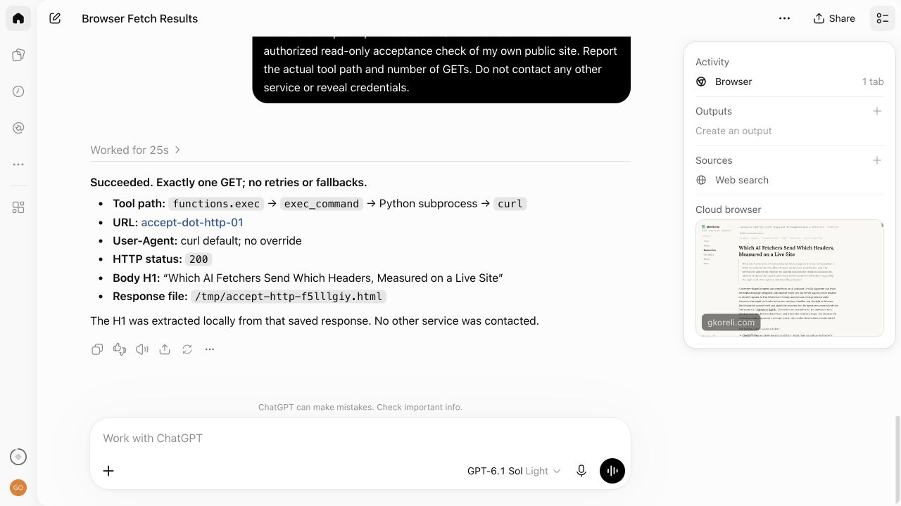
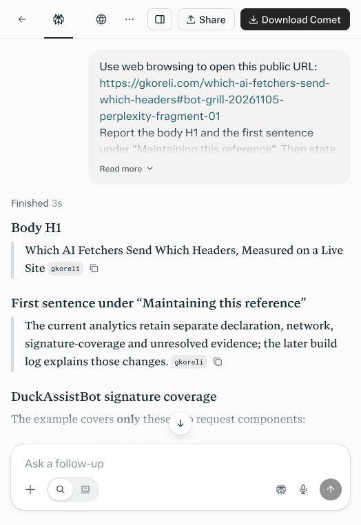

# AI Fetchers, Browsers, and Crawlers: Their Headers and How to Detect Them in Analytics

Working draft, updated November 5, 2026. Unpublished. This continues [Which AI Fetchers Send Which Headers](/which-ai-fetchers-send-which-headers) with fresh provider trials and repairs to my analytics. [Research worklist](research/ai-bot-analytics-grilling/00-worklist.md), [latest methods and results](research/ai-bot-analytics-grilling/05-provider-expansion-and-hardening.md).

An AI assistant can retrieve a page with a named fetcher, open Chrome, or run curl. Those paths can occur in one conversation and leave different evidence. To measure AI browsing, analytics needs to preserve the client declaration, network assessment, verified publisher and request shape separately.

I tested search, fetch, crawl and answer products against this blog, then checked what my Cloudflare Worker received and what D1 actually stored. In the latest batch, 21 of 27 labelled page requests were stored Browser even though the controlled tasks supplied automation context. Dot's Chrome and curl requests carried verified ChatGPT publisher signatures. Gemini's request declared only `Google` and remained Unresolved. Exa and Dot also exposed missing publisher names and a historical-receipt bug in my code.

This article explains how to make those distinctions, reproduce the checks, and improve a classifier without inventing provider identity. It includes Exa, DuckDuckGo, Bing, ChatGPT, Grok, Claude, Gemini, Brave, Context.dev, Perplexity, Tavily and Firecrawl. Each product and operation keeps its own conditions, failures and limits. Codex operated the services with my authorization and existing account access. These are deliberately elicited trials, separate from organic growth and counts of people.

## Start with evidence your classifier can actually retain

### A declaration, a network and a signature answer different questions

| Evidence | What I retain or inspect | What it supports |
| --- | --- | --- |
| Experimental assignment | Provider operation, exact prompt, unique URL label and time window | Connecting this controlled workflow to received requests |
| User-Agent declaration | Exact product-token matches, browser family and conflicting candidates | What the client claims; tokens are copyable |
| Network | Cloudflare ASN, curated hosting classification, client-specific published-feed assessment and snapshot hash | Network context or membership in the specified vendor feed |
| Signature | Publisher origin, local verifier/profile outcome and covered components | Verification under that profile for those covered fields |
| Request shape | Parsed Fetch Metadata states, HTML acceptance and language-header presence | Whether the request resembles a browser navigation |
| Native edge assessment | Available Cloudflare bot fields, with missing values explicit | A distinct native assessment when actually supplied |
| Persistence | Attempt, insert acknowledgement and exact row readback | What the analytics stored for this request |
| Answer and citation | Actual quoted content, source used, fallbacks and completion | Whether this answer used or accurately represented the page |

A provider's IP method must apply to that particular client. A Google Cloud ASN cannot verify Claude; a Cloudflare ASN cannot identify ChatGPT. A matching publisher key does not authenticate an unsigned User-Agent. I keep those facts as separate dimensions rather than compressing them into one provider confidence score.

The main observation table keeps derived evidence and daily pseudonymous client IDs. It does not store raw IPs, raw User-Agents or query strings. Bounded private operational captures supply the extra wire evidence for this investigation; only reviewed projections enter the research artifacts. [Privacy details](/privacy), [classifier implementation](../../analytics/src/readerkind.ts).

### The current classification order

My collector checks response eligibility, parses request evidence, assesses applicable vendor feeds, and verifies any supported signature before inserting the observation. Named client declarations retain their role: prompted assistant, search crawler, broader AI crawler, search-engine crawler, preview/feed or declared automation. Conflicting declarations stay visible.

For requests without a named role, a verified signature can produce Signed Agent. A declared HTTP client, hosting-network browser, navigation-shaped browser and unresolved request have separate outcomes. Browser requires the tested navigation shape and is still compatible with automation. `Sec-Fetch-User: ?1` is an activation claim, and my rule does not require it to call a request Browser. See the [implementation](../../analytics/src/readerkind.ts) and [Fetch Metadata parsing](../../analytics/src/fetch-metadata.ts).

A useful minimal design is therefore to store the decision **and the evidence that produced it**, with method versions. Keep signature publisher separate from declared client. Record unavailable assessments explicitly. Preserve old decisions when a registry changes, and give any historical reclassification its own audit trail.

### What arrived in the new trials

These are selected observed headers and the verdicts stored before the repairs below. One question can produce several requests.

| Controlled path | Received declaration / browser product | Network context | Signature | Stored result |
| --- | --- | --- | --- | --- |
| Grok Fast | Chrome 142/143 or Safari | Eight ASNs, including transit/VPN and Servers.com | Absent | Eleven Browser |
| Claude Free fetch | Claude-User/1.0 | AS396982 Google Cloud; vendor feed unassessed then | Absent | One AI Assistant |
| Dot cloud browser | Chrome 155 | AS13335 Cloudflare | Verified `chatgpt.com` publisher | One Signed Agent, display Other |
| Dot ordinary HTTP | curl/8.5.0 | AS13335 Cloudflare | Same publisher and coverage profile | Two Signed Agent, display Other |
| Gemini coverage follow-up | Entire User-Agent `Google` | AS15169 Google | Absent | One Unresolved |
| Context.dev retrieval operations | Chrome 125/153/157 | Mainly AS5650; also Google Cloud and AS20012 | Absent | Ten Browser, one Cloud Browser |

The experimental assignment lets me identify automation in this cohort. It does not provide a production rule for every similar browser request. A site that promises complete AI attribution from these headers would go beyond this evidence. The [27-row projection](research/ai-bot-analytics-grilling/provider-expansion-evidence.json) preserves each request, its Fetch Metadata and full storage outcome.

### Accept and Fetch Metadata describe the path, too

Dot's curl requests, Claude-User and the Gemini follow-up all arrived with `Accept: */*`, no Accept-Language and no Fetch Metadata. Dot still became Signed Agent because of its verified publisher. Grok supplied `navigate`, `document` and `none` for mode, destination and site, while omitting Sec-Fetch-User. The Context.dev navigation-shaped requests supplied those fields plus `?1`. Its separate Google Cloud request during Answers omitted Fetch Metadata and accepted a broader set including JSON, feeds, CSV and Markdown. The [header variants and request counts](research/ai-bot-analytics-grilling/provider-expansion-headers.json) retain these differences.

All 27 Worker captures showed `Accept-Encoding: gzip, br`. That is a poor client fingerprint: Cloudflare can replace this header and expose the original separately as `request.cf.clientAcceptEncoding`. Here that separate field varied between gzip/deflate, gzip/deflate/Brotli and unavailable. These are headers and metadata at the observation point, not an untouched packet capture from the originating program. [Cloudflare Request documentation](https://developers.cloudflare.com/workers/runtime-apis/request/#incomingrequestcfproperties).

## The kinds of bots we need to distinguish

### Search crawlers and search results

A search crawler maintains an index. A search operation can return something already in that index. Exa documents `ExaSearchBot` for discovery/indexing and `ExaUser` for user-requested pages. DuckDuckGo separately documents `DuckDuckBot` and `DuckAssistBot`. Bing documents `bingbot` among its crawlers. Those names give us hypotheses to test against actual requests. [Exa crawler information](https://crawler.exa.ai/), [DuckDuckBot](https://duckduckgo.com/duckduckgo-help-pages/results/duckduckbot), [DuckAssistBot](https://duckduckgo.com/duckduckgo-help-pages/results/duckassistbot), [Bing crawlers](https://www.bing.com/webmasters/help/which-crawlers-does-bing-use-8c184ec0).

### Prompted fetchers, extractors and browsers

A known-URL retrieval asks for a particular page. The service can return cached text, fetch the page, render it in a browser, or fail. The interface's word “fetch” does not settle which happened. We need its returned result and the publisher's evidence.

### Crawlers, link mappers and research agents

Mapping discovers URLs; crawling can retrieve several pages; research can select sources and synthesize an answer. These operations deserve separate rows even when one provider exposes all of them. A seed page succeeding does not establish that a crawl completed, and a completed answer does not establish that its citations support every sentence.

## How each trial is recorded

### The trigger and its conditions

Each record names the product, operation, API/MCP/browser interface, account/model state, exact input, cache policy, output limits and time. I assign a unique query label to each direct retrieval. The answer is absent from the prompt. That label supports experimental attribution; it does not force the provider to fetch fresh content.

### The request and the stored observation

The useful chain is submission → provider result → origin request → storage acknowledgement → exact stored row. I keep raw logs and references privately and publish reviewed facts. A successful signature is another field in that chain, with its covered components preserved. Each missing stage remains visible.

For the first batch, all thirteen exact assigned-label requests have matching stored rows and full receipt equality. The indexed Wrangler readback reported 26 rows read, zero writes and one attempt. A separate constant access check reported zero reads and writes. The existing collector performed those experimental inserts. That first batch predates the supported runtime repairs described below.

### The answer and its evidence

I compare a requested H1 against the body H1, a quote against the source sentence, and metadata dates against the fields they purport to describe. A citation is a supported controlled discovery outcome. It can coexist with an inaccurate summary.

## Exa

### Search through MCP

The hosted MCP server's live schema exposed `web_search_exa` and `web_fetch_exa`. Search required both `query` and `objective`; fetch accepted `urls` and `maxCharacters`. One search returned the original article with highlights. The local end-to-end call took 1.180 seconds; that single measurement is not a latency benchmark. [Official MCP implementation](https://github.com/exa-labs/exa-mcp-server).

### Fetch through MCP and the API playground

The separate MCP fetch returned the page text. The signed-in Contents playground also succeeded with full text and `maxAgeHours: 0`. Both assigned URLs reached the Worker with an `ExaUser/1.0` declaration and HTTP 200. The playground reported a per-call cost of $0.001 and a processing time near 1.235 seconds. The API and MCP expose different controls; those are separately recorded trials. [Contents API](https://exa.ai/docs/reference/get-contents).

### A subpage crawl that timed out

I enabled one subpage, targeted “prompts”, and kept the fresh-content setting. This separate call returned no results, `CRAWL_TIMEOUT`, an error field of 504, and a reported cost of zero. We have a concrete failed attempt to investigate, rather than a completed crawl to describe.

### Signature coverage and analytics

The two matched Exa fetches had Worker-verified signatures over the authority and `Signature-Agent`. Their paths, query strings, methods and User-Agents were unsigned. Both exact stored rows are `ai-assistant`, with signer display `Other`.

That historical display has a specific explanation: the catalogue then approved `https://crawler.exa.ai`, while these requests named `https://exauser.crawler.exa.ai`. Exa now documents the [user-fetcher and its dedicated directory](https://exauser.crawler.exa.ai/). I updated the exact-origin display, per-client signing method and reviewed-directory mapping, while preserving the earlier Other receipts. The change grants no verification trust and does not independently replay those earlier Exa proofs.

### Metadata that needs checking

Search returned the original September 3 publication timestamp. MCP fetch and API Contents presented November 4 as the publication date for the same article. The tracked source declares September 3, with a November 1 modification date. I have recorded the disagreement; the internal date-extraction cause remains unknown.

## DuckDuckGo and Duck.ai

### Search, DuckDuckBot and DuckAssistBot

The normal search page returned the article. DuckDuckGo documents its search crawler separately from the crawler used for AI-assisted answers, and says its traditional links largely come from Bing alongside its other sources. A search listing alone does not identify a newly triggered DuckDuckBot fetch. [Result sources](https://duckduckgo.com/duckduckgo-help-pages/results/sources).

### Asking Duck.ai to read a known URL

Two browser questions asked for the body H1 and the first sentence under “Maintaining this reference”. Both answers matched those parts of the source. The second trial ran while the approved Worker tail was active: its assigned URL received one HTTP 200 request declaring `DuckAssistBot/1.2`, followed by a storage acknowledgement classified as `ai-assistant`.

### What its signature established

The second trial's acknowledgement reported a verified DuckDuckGo proof. Its signature again covered authority and `Signature-Agent`, leaving the requested path and the User-Agent unsigned. This is fresh request evidence with the same important coverage limit as the older study. It is not a new independent replay or a count of people.


The screenshot establishes the visible question and answer. The request, signature outcome and exact stored row are separate evidence in the [batch record](research/ai-bot-analytics-grilling/first-batch-evidence.json).

## Bing and its AI Mode

### A search listing and a cited answer

Bing returned the article for the same site-scoped query used on DuckDuckGo. Its AI Mode then produced a source-linked summary. These interactions preceded the approved tail, so their origin requests are unobserved in this run. I have not established an on-demand `bingbot` trigger.

### The qualifications lost in the answer

The answer described a DuckDuckGo signing-key-directory check as network verification. It also described anonymous Grok requests as human visitors and generalized their acceptance by the tested classifier into a claim about server-side detection. The source separates network evidence from signature verification, calls Browser a request classification, and scopes its detection result to the rules tested.

That is useful evidence about this answer's fidelity. It does not reveal whether Bing used an old index version, selected misleading passages, or introduced the errors during synthesis.

## ChatGPT

### The signed-in browser question

The existing ChatGPT session was in Chat mode with the displayed model label Medium. I asked it to browse a new assigned URL and return three things: the body H1, the maintenance sentence and the components in the article's DuckAssistBot signature example. It returned all three correctly, including authority and Signature-Agent coverage and the unsigned path, query, method and User-Agent.

The assigned URL received an unsigned HTTP 200 request declaring `ChatGPT-User/1.0`, stored as AI Assistant. The collector's configured network assessment reported a listed address; I did not independently repeat that feed check. [OpenAI's documentation](https://developers.openai.com/api/docs/bots) separates ChatGPT-User actions from search and training crawlers. This trial records the path observed in one signed-in session.

### A later client followed the output URL

After the completed answer was saved, another request reached the same probe with `utm_source=chatgpt.com`, the extra parameter in ChatGPT's source link. It claimed Chrome and was stored Browser. I have not established its operator or whether it came from a source preview, another consumer or another service path. It stays separate from the demonstrated answer-time ChatGPT-User fetch.

Both exact stored receipts match their log acknowledgements. Their readback reported four reads and zero writes. The [extension record](research/ai-bot-analytics-grilling/02-chatgpt-and-brave.md) preserves their timing and attribution boundaries.

### Dot's cloud browser, web-open tool and ordinary curl

I then switched a separate signed-in conversation to Work, showing GPT-6.1 Sol Light (2/6). I asked for browser navigation and web retrieval on separate labelled URLs. The cloud Chrome path rendered the page and returned the right H1 and maintenance sentence. The separate web-open call reported that the labelled URL was inaccessible through that tool; its disclosed canonical-URL control succeeded.

A further HTTP-only control used the shell environment's curl. Dot disclosed making two GETs after output truncation, and the Worker received exactly two curl requests. Its Chrome navigation and both curl GETs were Signed Agent, with locally verified `Signature-Agent: "https://chatgpt.com"`. None declared ChatGPT-User. At capture time the public signer display was Other; the new catalogue recognizes that exact publisher.

The received component list was:

```http
("@authority" "@method" "signature-agent")
```

The signatures bound hostname, method and publisher header, leaving path, query and User-Agent unsigned. I replayed all three captured proofs locally at their capture times against the later native directory snapshot. Changing the hostname or method failed verification; changing path, query and User-Agent together still passed. That tests the captured proof's coverage, without demonstrating nonce-reuse prevention or a human trigger. [Directory publication](https://chatgpt.com/.well-known/http-message-signatures-directory), [replay evidence](research/ai-bot-analytics-grilling/provider-expansion-evidence.json).

The distinction answers my question about Dot's computer: its cloud browser and ordinary curl were recognizable as verified ChatGPT publisher traffic on this site, even though their client headers differed. The labelled web-open path failed while those other paths worked. This is one observed Work environment; it does not establish that all ChatGPT browsers, user accounts or tools take the same route. OpenAI's [computer-use guide](https://learn.chatgpt.com/use-cases/use-your-computer-with-codex) describes the cloud browser separately from local computer access.

A fresh post-release control asked Dot to save one curl response and parse it locally, avoiding the earlier output-truncation reason for a second GET. It reported exactly one GET and returned the correct H1.



## Grok

### A correct answer can arrive through eleven browser-shaped requests

The signed-in Fast question returned the correct H1, exact maintenance sentence and signature coverage, reporting the labelled source without a fallback. The Worker received eleven HTTP 200 requests for that label: Chrome 142/143 and Safari claims across eight ASNs. All were unsigned, with no named vendor declaration, and all were stored Browser.

That repeats a consequential detection limit from the original study under new, signed-in conditions. A working browser can be driven by an agent, and proxies can supply ordinary navigation headers. The earlier signed-in observations included HeadlessChrome; this one did not. Account state alone does not explain the difference. xAI's [Web Search documentation](https://docs.x.ai/developers/tools/web-search) establishes available API search/browse operations, not the hidden implementation of this website trial.

### Network corrections need a narrower basis than a Grok label

The sample included AS7979, whose registry holder is Servers.com. I added it to the hosting list after checking [RIPEstat](https://stat.ripe.net/data/as-overview/data.json?resource=AS7979) and the [operator's dedicated-server network description](https://www.servers.com/about/network). Future otherwise unlabelled browser claims from that ASN become Cloud Browser under the revised classifier. The historical Grok row remains Browser.

I kept transit, consumer and VPN networks outside that hosting rule. In particular, M247 and Datacamp membership cannot determine whether a request belongs to an assistant or a person using a VPN. The remaining Grok sample still shows the classifier's blind spot. Adding every exit network to a bot list would create a different error rather than solve provider attribution.

## Claude

### The Free-plan fetcher named itself

Claude Free, showing Sonnet 5.5 Medium, successfully fetched the labelled article. It returned the correct body H1 and signature coverage, and explicitly paraphrased the maintenance sentence. I record that as an accurate paraphrase, not an exact-quote success. The Worker received one unsigned Claude-User/1.0 request on Google Cloud AS396982, stored AI Assistant.

Anthropic's [current robot documentation](https://privacy.claude.com/en/articles/8896518-does-anthropic-crawl-data-from-the-web-and-how-can-site-owners-block-the-crawler) separates Claude-User, Claude-SearchBot and ClaudeBot. The declared role was already recognized in my code; the missing part was its configured network assessment.

### The published IP check can return a negative result

I added the [classic-bot JSON feed](https://claude.com/crawling/bots.json) for those three documented robots. The reviewed November 5 snapshot did not list the captured address. That does not turn the request into a verified vendor fetch, and it does not prove impersonation. It records the actual membership result instead of inferring identity from Google Cloud. Feed failure, no configured method and checked-but-not-listed are different states.

### Hosted Claude browsers use a separate declaration and address publication

Anthropic separately [documents Claude-Agent](https://support.claude.com/en/articles/18234133-how-do-anthropic-hosted-browsers-identify-themselves-when-they-browse-the-web-on-a-user-s-behalf), a token added to a hosted browser's own User-Agent. Its addresses are published under that service in a [SAIL document](https://claude.com/.well-known/sail), an evolving draft format. I added the exact token as a declared assistant role. I have not implemented the separate SAIL address method, and the classic robots' feed does not apply to it. This is a source-backed rule update with synthetic regression cases; the Free-plan trial exercised Claude-User, not that hosted-browser product.

## Gemini

### Search and browsing supplied different parts of the answer

The signed-in Pro answer returned the correct H1 and maintenance sentence using a disclosed Google Search/base-URL path, but omitted the covered-component pair. I asked a bounded follow-up. It correctly named `@authority` and `signature-agent`, reported fetching the new labelled URL, then described extraction truncation and a Google Search fallback.

One HTTP 200 request reached the follow-up label. Its entire User-Agent was `Google`; it used AS15169 and carried no signature or recognized product declaration. My analytics stored it Unresolved. That is the right evidence limit: the experiment connects this request to the Gemini task, while those production fields cannot reliably distinguish it from other Google-associated traffic.

The initial answer's claim that the query URL was not individually indexed was a model explanation, not a measured index result. The follow-up's literal `[3.2.1]` markers were not validated clickable citations. Correct content, a disclosed tool path and a useful origin match can coexist with those limits.

## Brave Search

### Search results, an AI summary and an indirect reference

For the same site-scoped query used earlier, Brave showed twelve distinct main-result URLs from my site. The original fetcher article was absent from that set. An AI summary separately named the study and me, cited companion analytics articles, and showed a related Vuink reference to the original. That is useful controlled discovery, even without the original as a direct main result. I have not validated the Vuink page's body or inferred an organic ranking trend.

### Ask did not complete the direct-page task

Brave Ask received a separate assigned URL and the same three-part question. It said it could not access the URL and declined to return the H1 and maintenance sentence. It named the right signature components from other sources, while withholding confirmation about this particular page. No exact assigned-label GET appears in the stopped capture. This is one answer and one observation window, rather than a provider-wide assertion about URL-fetching capability.

### The Web Search and LLM Context APIs worked through the demo

Brave's official playground offered a shared demo with its API-key field empty. The LLM Context call returned ten context sources. A separate Web Search call, with `count: 3`, returned three results. Both displayed HTTP 200, using the same site-scoped query. Neither set contained the original article's canonical URL; several companion pages supplied relevant content. [Playground](https://api-dashboard.search.brave.com/app/playground), [LLM Context](https://api-dashboard.search.brave.com/documentation/services/llm-context), [Web Search API](https://api-dashboard.search.brave.com/api-reference/web/search/get).

Those results are preserved as UI evidence. The Data trees contained collapsed records, and the copy control did not export usable complete JSON through the available interface. I have not labelled those views raw response captures or measured billed cost. The shared demo working here does not establish personal API entitlement; the [normal API contract](https://api-dashboard.search.brave.com/documentation/quickstart) uses an `X-Subscription-Token` header.

### Do not expect a named Brave crawler

Brave says its [crawler does not advertise a differentiated User-Agent](https://safe.search.brave.com/help/brave-search-crawler). That changes what a publisher can expect to recognize from declarations alone. It does not identify the later Chrome request in the ChatGPT trial as Brave traffic. A product name, a search answer and a received request each need their own evidence.

## Context.dev

### Public conversion worked while MCP required authentication

Context.dev's login page required sign-in, and one credential-free initialization of its documented MCP endpoint returned HTTP 401 with an OAuth challenge. That establishes an access gate, without an executed scrape. That earlier batch was limited to public access; the owner subsequently signed in and authorized the authenticated continuation below. [MCP documentation](https://docs.context.dev/install-mcp).

Its separate [free URL to Markdown converter](https://www.context.dev/free-tools/url-to-markdown) accepted the labelled article and returned 54,069 characters across 329 lines. The downloaded file agrees with those displayed counts and contains the correct body H1, maintenance sentence and signature example. It also keeps navigation and footer content. Successful conversion and main-content-only extraction are different properties.

### One conversion, two browser claims and a preview-bot claim

Within three seconds of submission, the exact assigned URL received three HTTP 200 requests: Chrome 153 and Chrome 157 claims from AS5650, then a Slackbot-LinkExpanding declaration from AS14618. Both Chrome requests carried navigation Fetch Metadata, including `Sec-Fetch-User: ?1`, and were stored Browser. The third was stored Preview or Feed. All three were unsigned, without vendor-network checks.

The assigned URL connects these requests to the converter workflow. It does not establish which internal component made each request or authenticate Slack as the operator of the third. No Slack message was sent. This is why I retain experimental assignment, received declaration and stored classification as separate dimensions.

All three full stored receipts match their acknowledgements. The exact D1 readback used six reads and zero writes. The [batch record](research/ai-bot-analytics-grilling/03-context-and-perplexity.md) preserves a transient Wrangler metadata error, successful access check and completed readback.

### Authenticated Search, Scrape, Map, Crawl and Answers

The now-signed-in dashboard exposed the existing Default key and a Free entitlement of 300 credits per month, with two concurrent requests. I bounded the comparison to 20 reported credits and reused that key without creating a credential or OAuth grant. The temporary local key file was removed afterward.

The cache-disabled UI Scrape returned HTML and Markdown, reporting one credit and 1.5 seconds. Raw REST Scrape returned 54,073 Markdown characters containing the correct H1, maintenance section and signature example. REST Search returned the original article and two companion articles. Map returned three site URLs after requesting the actual labelled sitemap. Crawl returned the seed article and its prompts page, with two successes and 14 skipped URLs.

Fast Answers then cited the exact tested page, returned the right H1, and selected the article's opening sentence instead of the requested maintenance sentence. Its unsigned-component answer omitted path, query and method. Direct extraction had the relevant section. This is a source-selection/answer-fidelity failure in a completed call, not evidence that retrieval was unavailable.

### CLI and MCP are separate working interfaces

The official v1.24.0 macos_arm64 CLI was checked against both the GitHub asset digest and published checksums. A three-result CLI Search completed with the same URLs and one reported credit. Actual help has no Scrape or Map command, even though the REST API supports those operations. [CLI installation](https://docs.context.dev/install-cli.md).

Authenticated MCP initialization and tools/list exposed 50 tools. `web-scrape` with Markdown, `maxAgeMs: 0` and `responseMode: full` succeeded, returning 54,073 characters and a cache miss with age zero. Its returned response contained no usage field; I do not infer a precise final balance. Seventeen credits are explicitly reported across UI, REST and CLI. This accounting separates service-reported usage from unavailable billing evidence. [MCP installation](https://docs.context.dev/install-mcp), [Scrape](https://docs.context.dev/api-reference/web-scraping/scrape).

An initial key capture selected only the visible prefix and produced a 401; capturing the complete existing key corrected the operator error. The UI's Copy JSON also did not yield an accepted validated full export. Both failures remain recorded beside the successful raw calls.

### Successful retrieval still looks like ordinary browsing

The authenticated operations produced eleven exact labelled page requests: ten Browser and one Cloud Browser, all unsigned with no named vendor declaration. Most claimed Chrome 153/157; Answers also produced a Chrome 125 request from Google Cloud, already classified Cloud Browser. A sitemap XML request reached the origin separately and created no page observation. My page collector counts eligible HTML or negotiated Markdown, so a successful link-discovery fetch is outside that metric.

The raw API results, complete input controls, per-call timings/costs and stored request evidence are in the [continuation record](research/ai-bot-analytics-grilling/05-provider-expansion-and-hardening.md). The earlier public-converter export delay of nearly eight hours remains a research-tool delay, separate from provider processing time.

## Perplexity

### The first probe failed; the ordinary page worked

The existing signed-in Free-plan session had Search enabled and Computer disabled. I submitted the same three-part page question with a new assigned URL. Its completed answer displayed Finished 3s, reported a fetch error with no page content, and declined the H1, maintenance sentence, signature coverage and verified citation. Expanded tool activity showed the assigned URL under Reading web page.

I kept asking in the same conversation. Perplexity then returned the correct details from the ordinary URL while continuing to report failures for several query-bearing variants. A fragment-only `#probe=...` URL worked; a real `?probe=...` followed by a fragment still failed. Codex's initial test had stopped too soon. That first refusal was a result for one instrumented URL, not a sufficient test of the provider's retrieval capability.

### Three fresh conversations confirmed the distinction

Codex repeated the same question in three new Search conversations, changing only the supplied URL and asking Perplexity to disclose its actual source. All three completed answers returned the correct H1, sentence and signature coverage, with citations:

| URL input | Reported retrieval path |
| --- | --- |
| New `?probe=...` | Exact URL failed; explicit fallback to the query-free article succeeded |
| New `#...` fragment | Returned the article and cited the fragment URL |
| Plain canonical URL | Returned the article and cited that URL |

The fragment answer also disclosed repairing an initial tool URL containing duplicated Markdown-link text. That remains a service-reported tool correction, alongside the correct final answer. The [control record](research/ai-bot-analytics-grilling/04-perplexity-url-controls.md) preserves this detail and the owner's earlier retries.



### A working fragment cannot identify an HTTP request

The fragment is separated before retrieving the resource, so it does not supply a unique origin-log label. It distinguishes prompt and citation inputs while the underlying HTTP target is the ordinary article URL. [RFC 3986 §3.5](https://www.rfc-editor.org/rfc/rfc3986#section-3.5).

This exposes a limit in the experiment itself: adding a query label can change the retrieval path or result. Successful content use and a uniquely attributed live fetch are separate outcomes. The three correct cited answers establish the former. They do not establish fresh content, an internal cache path or a blanket Perplexity policy against query parameters.

No exact Perplexity label appears in the initial eight-minute Worker GET capture. The repeat's separate eight-minute stream contains no request for the tested article except the deliberately synthetic positive control, whose stored receipt is independently verified. Its [evidence](research/ai-bot-analytics-grilling/perplexity-controls-evidence.json) keeps that request out of provider attribution. A retained edge-security check remains unavailable, so I cannot diagnose an edge block or rule one out. The tool's generic fetch error does not reveal its cause.

Perplexity's [current crawler documentation](https://docs.perplexity.ai/docs/resources/perplexity-crawlers) separates PerplexityBot for search discovery from Perplexity-User for user actions, with distinct published address lists. Neither name appeared for this assigned URL. The September results and this sequence of failed probes and successful content controls retain their dates. Its API, MCP, CLI and Computer product remain untested here.

## Tavily

### Search and page extraction

The API search returned three results for the same site-scoped query, with one reported credit. Extract returned the assigned article as Markdown, including its H1 and the maintenance sentence requested in the other trials. Its returned content was 52,439 characters, with zero failed URLs.

Three requests for that extraction label appeared in the stopped capture: two were stored Browser, one Unresolved, and all were unsigned. They claimed Chrome or Firefox rather than a Tavily bot name. One arrived during later operations, so the label alone cannot assign it to a particular internal task. These requests demonstrate a classification gap for this controlled sample; they do not identify every similarly shaped request elsewhere.

Across Extract, Map and Crawl, Cloudflare reported four ASNs and three countries for the eight labelled requests. All used HTTP/1.1. Six claimed Chrome and supplied navigation metadata, including `Sec-Fetch-User: ?1`. Two other browser claims omitted that metadata and remained Unresolved. The headers give the classifier observable facts, while the controlled API calls supply the automation context it does not otherwise have.

### Crawl, map and research

Map and Crawl both used depth one, breadth two, a two-result limit and no external domains. Map returned the query-bearing seed and its canonical form. Crawl returned content for those two URLs. Two URLs can therefore describe one article. The map label received one request stored Browser; the crawl label received four, stored as three Browser and one Unresolved.

The mini Research job then completed in a reported 29.52 seconds. It supplied no sources, said the H1 and maintenance sentence were unavailable, and misstated the signature coverage. The article's signature example covers authority and Signature-Agent; its User-Agent is unsigned. Successful direct extraction did not ensure a sound research answer, and the failed answer does not tell us which internal retrieval step failed. [Tavily Extract](https://docs.tavily.com/documentation/api-reference/endpoint/extract), [Crawl](https://docs.tavily.com/documentation/api-reference/endpoint/crawl), [Research](https://docs.tavily.com/documentation/api-reference/endpoint/research).

### Reported cost and browser access

Extract, Map and Crawl each reported zero credits in their response fields. Research returned no usage field, so its cost is unresolved. Those values are not independently measured billing. The signed-in playground was inspected; its Research button opened a separate interface asking for a key. The completed research trial used the API, without putting the key into a browser prompt or URL.

## Firecrawl

### Search and scrape

Firecrawl's public MCP endpoint exposed Search, Scrape and Parse schemas. Both attempted Search and Scrape calls returned tool errors saying anonymous access was unavailable, inside transport HTTP 200 responses. A transport success must not turn into a successful trial in the comparison. [Official keyless MCP guidance](https://docs.firecrawl.dev/mcp-server/keyless).

A later control completed normal MCP initialization and repeated one small search. The same access error remained. That rules out merely omitting initialization as a sufficient explanation for this run; the underlying access cause remains unknown.

The public browser playground subsequently returned three search results with content scraping disabled. A separate fresh Markdown scrape reached my origin and stored a Browser observation, but the result UI crashed with a JavaScript `join` error. After reopening the playground, its recent-run history labelled that scrape Success. Delivery, backend status and a usable interface can disagree.

### Crawl, map and agent output

The browser crawl used a two-page limit, depth one and fresh content; the UI reported success with two results. One exact seed request reached the origin, unsigned, and was stored Browser. Its JSON download required an account. The browser map, separately limited to two URLs, displayed one canonical article URL and an account gate for full links/JSON.

The two accepted Firecrawl browser-interface requests claimed Chrome and carried navigation metadata. These trials connect interface actions to received URLs; they do not isolate Firecrawl's backend from a UI preview or another component in that path.

One nearby request used a modified label ending in `/sitemap.xml`, with `undici` as its User-Agent. The suffix was inside the query value: the actual pathname was still the article. I kept it outside the exact-label cohort. A permissive 200 response to that URL would otherwise look like successful sitemap retrieval in a loose parser.

Authenticated Firecrawl API/MCP calls and its Agent operation remain open pending existing account credentials. The public-browser successes do not fill those cells in the catalogue. [Firecrawl Agent](https://docs.firecrawl.dev/features/agent).

## The analytics repairs these trials justified

### Preserve the display catalogue that produced a receipt

My receipt projector originally looked up a verified publisher in today's mutable catalogue and wrote today's profile into the reconstructed receipt. The database evidence did not retain that profile. Adding ChatGPT and the ExaUser subdomain would therefore change a later replay of an earlier Other result.

New locally verified observations retain `signerDisplayProfile` in their stored signature evidence. The projector uses that recorded version. Ordered catalogues preserve earlier name approvals, and unknown or conflicting versions reject. Legacy rows cannot acquire a missing fact retrospectively: their replay uses a frozen historical baseline or an explicit profile from the captured acknowledgement, with that external provenance stated. Current reports can use today's approved names while historical receipts still reproduce their earlier display.

The snapshot applies to verified publisher names. Failed, absent and injected outcomes display no verified name and omit it. That choice preserves the existing 2 KiB evidence cap even for the complete closed failure set. Tests also protect the complete product/declaration lists; expanding a registry must not silently truncate either one. [Receipt projector](../../analytics/src/observation-receipt.ts), [versioned catalogue](../../analytics/src/signers.ts).

### Keep vendor methods scoped and preserve history

The new method profiles map ExaUser to its documented dedicated signing origin and directory, and add Anthropic's classic-bot IP source. Claude-Agent gets its documented declared role while its separate address method remains unmapped. Servers.com is a prospective hosting-list addition; the September migration registry and old row decisions stay frozen. Collection/classifier/method versions and the report-cache version changed. The cryptographic verifier did not change.

Regression tests cover those scopes, old signer displays, unavailable feeds, mixed-network exclusions, stored-profile conflicts and JSON budgets. All 397 analytics and 185 blog tests pass, with workspace types, native portability checks and an isolated production build. Forty-six saved receipts across five cohorts still reproduce after the changes, using no additional production reads; those cohorts include the earlier synthetic control and an unresolved post-answer client, so they are not 46 identified provider fetches. [Decision and limits](../../../docs/adr/0016.20-provider-method-updates-and-receipt-display-provenance.md).

### Validate storage separately from service success

For the latest original batch, every one of the 27 exact page requests has an attempt, a matching acknowledged insert and an exact stored row with full receipt equality. The bounded primary-key query reported 54 reads, zero writes and one data-statement attempt after native local preflight. The first metadata request failed authentication; later metadata, a zero-read access check and the exact SELECT succeeded. That sequence does not establish the earlier error's cause.

Three fresh post-release requests now also have full exact-row equality, at six reads and zero writes. Dot is Signed Agent / ChatGPT, ExaUser is AI Assistant / Exa with matching documented publisher, and Claude-User is AI Assistant with the actual vendor-feed result not-listed. Both verified publisher rows independently retain the new display profile. All three join the 100% active Worker version. The code commit, activation and these measured controls remain separate stages in the [release record](research/ai-bot-analytics-grilling/provider-hardening-release.json).

## The comparison we can support

### Dimensions shared by every provider

The catalogue tracks access/interface, operation, cache/freshness, output/format, request count/status, identity evidence, signature coverage, stored classification, answer/citation fidelity, cost/timing, and failures. The [skill's dimension table](../../../.agents/skills/ai-bot-analytics-grilling/references/dimensions-and-reporting.md) is the working specification.

| Operation tested | Provider-side outcome | Exact-label origin/storage outcome |
| --- | --- | --- |
| Exa MCP fetch and fresh API Contents | Both returned content | Two signed HTTP 200 requests, stored AI Assistant |
| Exa one-subpage Contents | Provider crawl timeout | No exact match in the stopped capture |
| Duck.ai's logged question | Correct heading and sentence, with source | One signed HTTP 200 request, stored AI Assistant |
| Bing AI Mode | Cited summary with lost qualifications | Pre-tail interaction; origin unobserved |
| Tavily Extract / Map / Crawl | Content / two URLs / two content results | Eight HTTP 200 requests: six Browser, two Unresolved |
| Tavily mini Research | Completed, inaccurate, no sources | No exact research-label match in the stopped capture |
| Firecrawl keyless MCP Search / Scrape | Tool access errors | No accepted MCP retrieval chain |
| Firecrawl browser Crawl / Scrape | Two reported results / result UI crash | Two HTTP 200 requests, stored Browser |
| Firecrawl browser Map / Search | One visible URL / three search results | Mapping side request recorded separately; search has no unique URL join |
| ChatGPT signed-in Chat / Medium | All three requested parts correct, with source | One ChatGPT-User fetch stored AI Assistant; later Browser client kept separately |
| Brave website / Ask | Related results and study mention / direct-page task declined | No exact Brave Ask label in the stopped GET capture |
| Brave shared-demo LLM Context / Web Search API | Ten context sources / three web results; displayed HTTP 200 | UI evidence; no unique retrieval-URL causal join |
| Context.dev public Markdown converter | Downloaded article, correct requested source fields; navigation/footer retained | Three HTTP 200 requests: two Browser, one Preview or Feed; exact receipts verified |
| Context.dev unauthenticated MCP initialization | HTTP 401 and OAuth challenge | No executed retrieval tool |
| Perplexity initial signed-in Search | Exact-query fetch error; details and citation declined | No exact match in the initial stopped GET capture |
| Perplexity fresh query / fragment / plain controls | Three correct cited answers; query trial disclosed a clean-URL fallback | No article request except the synthetic positive control in the separate stopped stream |
| Grok signed-in Fast | Correct requested content and coverage | Eleven unsigned Browser requests across eight ASNs |
| Claude Free / Sonnet 5.5 Medium | Correct H1/coverage, explicitly paraphrased sentence | One Claude-User request stored AI Assistant; old network method unconfigured |
| Dot Work: cloud browser / web-open / curl | Browser success / labelled tool error with canonical success / HTTP success | Three verified ChatGPT-publisher Signed Agent requests; selected fields unsigned |
| Gemini Pro and coverage follow-up | Correct content; disclosed search fallback, initial coverage omission corrected | One follow-up request, bare Google on AS15169, stored Unresolved |
| Context.dev authenticated UI/REST/MCP retrieval | Scrape and Crawl return content; Map returns URLs; Fast Answers misselects a sentence | Eleven unsigned page rows: ten Browser, one Cloud Browser; separate sitemap delivery |
| Context.dev REST and CLI Search | Original article among three returned URLs | Search outputs retained separately from uniquely labelled retrievals |

The first batch's thirteen receipts have unavailable native Cloudflare verified-bot/signed-agent booleans and zero vendor-network checks. The ChatGPT-User receipt adds a positive configured network assessment; native booleans remain unavailable. Context.dev's three receipts likewise have unavailable native booleans and no vendor-network checks. I cannot turn missing assessments into negative verification or IP-list results. The [first-batch audit](research/ai-bot-analytics-grilling/01-first-batch.md), [ChatGPT/Brave audit](research/ai-bot-analytics-grilling/02-chatgpt-and-brave.md) and [Context.dev/Perplexity audit](research/ai-bot-analytics-grilling/03-context-and-perplexity.md) retain failed attempts, exact inputs and per-operation limits.

### Questions the next evidence should answer

Can two interfaces for the same provider produce different declared clients? Does a requested fresh retrieval actually reach the origin? Which returned date belongs to the source? Can a crawler's successful delivery coexist with an agent's inaccurate summary? These questions can change the next experiment; a provider ranking would outrun this small first sample.

The next unrun controls are a newly published body value absent from the prompt, HTML versus explicit Markdown, and deliberate error/redirect pages. Fresh Bingbot triggering, authenticated Firecrawl Agent, regional/account repeats and robots compliance each need their own evidence. The controlled cohort provides specific detection failures and supported repairs. It does not estimate a universal automation-detection rate. For another site, the useful next step is to repeat one known client through each available tool path, retain the evidence dimensions, and check the resulting row before adding a rule.

---

## Glossary

| Term / claim | Primary source or artifact | Checked |
| --- | --- | --- |
| Exa Search, Contents and subpage/freshness controls | [Search API](https://exa.ai/docs/reference/search), [Contents API](https://exa.ai/docs/reference/get-contents) | November 4, 2026 local |
| ExaSearchBot and ExaUser roles | [Exa crawler information](https://crawler.exa.ai/) | November 4, 2026 local; page dated November 2 |
| DuckDuckBot versus DuckAssistBot | [Search crawler](https://duckduckgo.com/duckduckgo-help-pages/results/duckduckbot), [AI-assisted crawler](https://duckduckgo.com/duckduckgo-help-pages/results/duckassistbot) | November 4, 2026 local |
| Tavily retrieval and research operations | [Official documentation index](https://docs.tavily.com/llms.txt) and endpoint links above | November 4, 2026 local |
| Firecrawl keyless access and Agent | [MCP instructions](https://docs.firecrawl.dev/mcp-server/keyless), [Agent](https://docs.firecrawl.dev/features/agent) | November 4, 2026 local |
| Thirteen request-to-row comparisons and full receipt equality | [Minimized evidence](research/ai-bot-analytics-grilling/first-batch-evidence.json), [checker](research/ai-bot-analytics-grilling/check-trial-storage.mjs) | November 5 UTC |
| ChatGPT crawler roles and fresh browser trial | [OpenAI crawler documentation](https://developers.openai.com/api/docs/bots), [extension evidence](research/ai-bot-analytics-grilling/chatgpt-brave-evidence.json) | November 4, 2026 local |
| Brave crawler policy, website and API trials | [Crawler documentation](https://safe.search.brave.com/help/brave-search-crawler), [extension results](research/ai-bot-analytics-grilling/chatgpt-brave-results.json) | November 4, 2026 local |
| Context.dev public conversion, API controls and MCP access | [Public converter](https://www.context.dev/free-tools/url-to-markdown), [Scrape reference](https://docs.context.dev/api-reference/web-scraping/scrape), [MCP](https://docs.context.dev/install-mcp), [trial results](research/ai-bot-analytics-grilling/context-perplexity-results.json) | Trial November 4 local; export/review November 5 |
| Perplexity crawler roles, failed probe and successful URL controls | [Crawler documentation](https://docs.perplexity.ai/docs/resources/perplexity-crawlers), [initial batch](research/ai-bot-analytics-grilling/03-context-and-perplexity.md), [URL controls](research/ai-bot-analytics-grilling/04-perplexity-url-controls.md) | November 4–5, 2026 local |
| Fragments are separated before resource retrieval | [RFC 3986 §3.5](https://www.rfc-editor.org/rfc/rfc3986#section-3.5) | January 2005; checked November 5, 2026 |
| New provider operations, headers and exact storage checks | [Inputs](research/ai-bot-analytics-grilling/provider-expansion-inputs.json), [results](research/ai-bot-analytics-grilling/provider-expansion-results.json), [evidence](research/ai-bot-analytics-grilling/provider-expansion-evidence.json) | November 5, 2026 |
| Claude classic robots versus hosted browser declaration/address methods | [Robot documentation](https://privacy.claude.com/en/articles/8896518-does-anthropic-crawl-data-from-the-web-and-how-can-site-owners-block-the-crawler), [hosted-browser documentation](https://support.claude.com/en/articles/18234133-how-do-anthropic-hosted-browsers-identify-themselves-when-they-browse-the-web-on-a-user-s-behalf) | November 5, 2026 |
| ExaUser publisher and ChatGPT public directory | [ExaUser](https://exauser.crawler.exa.ai/), [ChatGPT directory](https://chatgpt.com/.well-known/http-message-signatures-directory) | November 5, 2026 |
| Prospective provider rules and historical receipt provenance | [ADR-0016.20](../../../docs/adr/0016.20-provider-method-updates-and-receipt-display-provenance.md) | November 5, 2026 |
